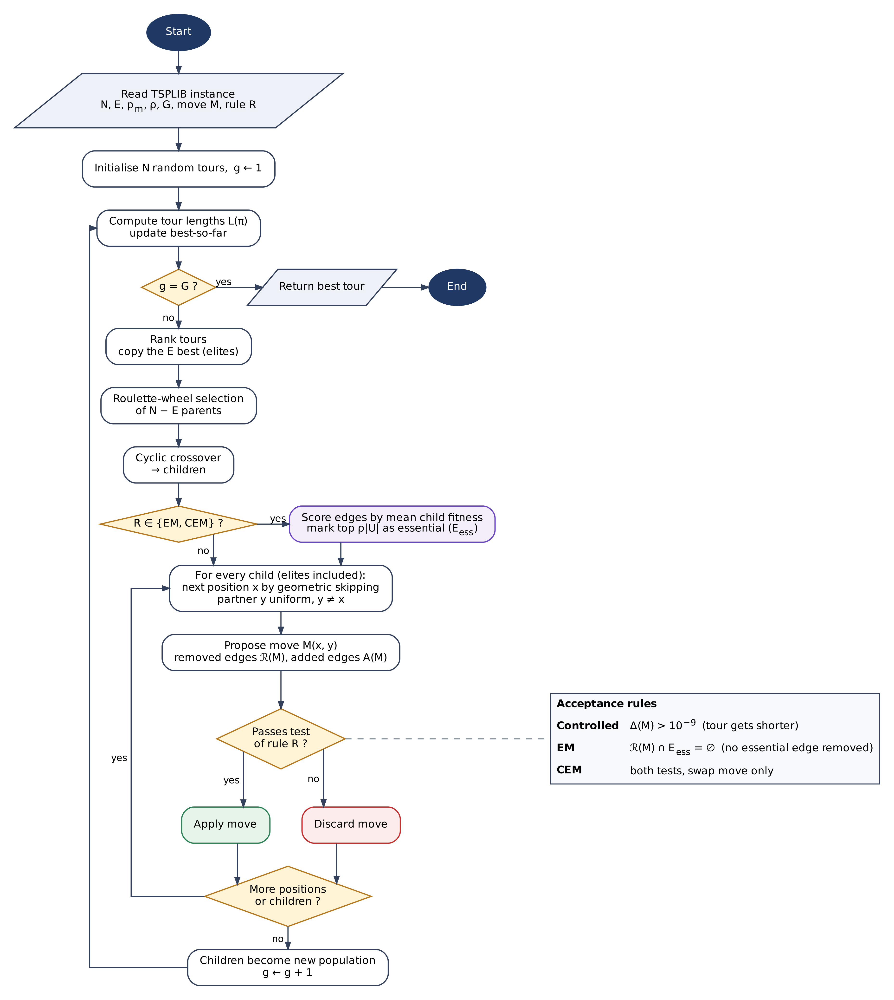
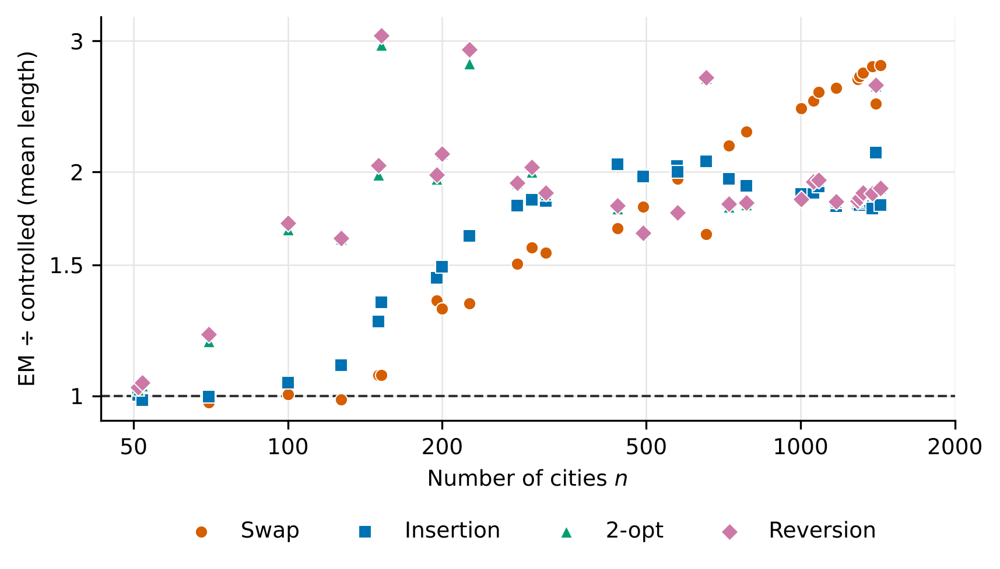
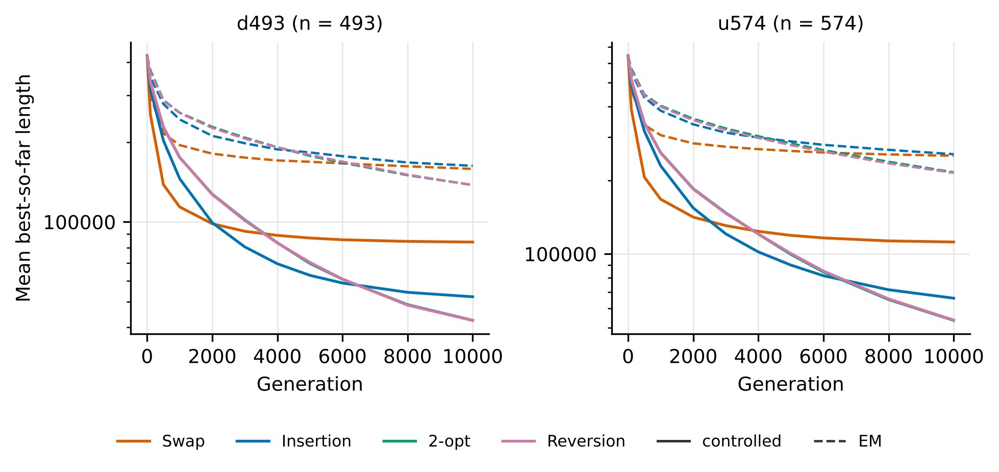
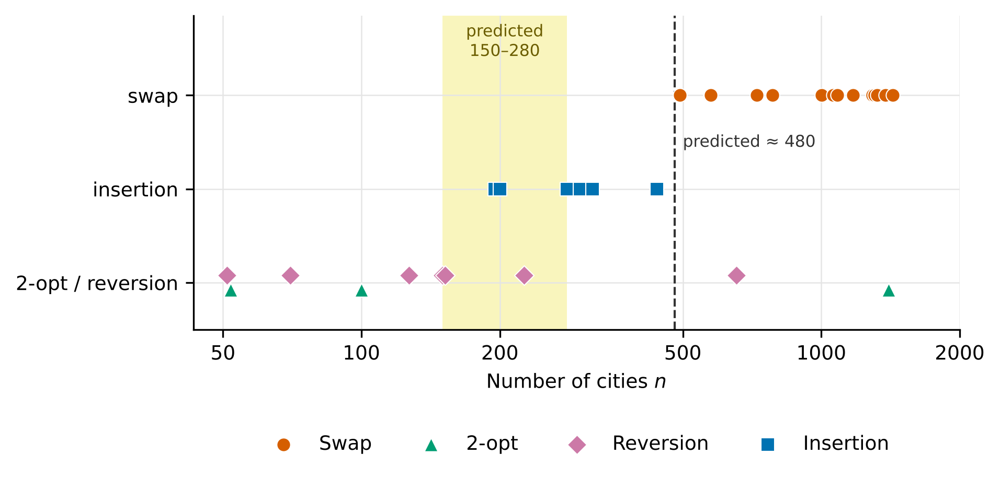
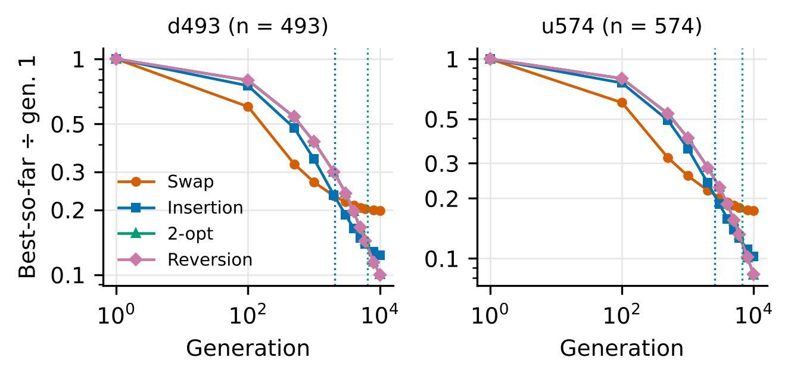
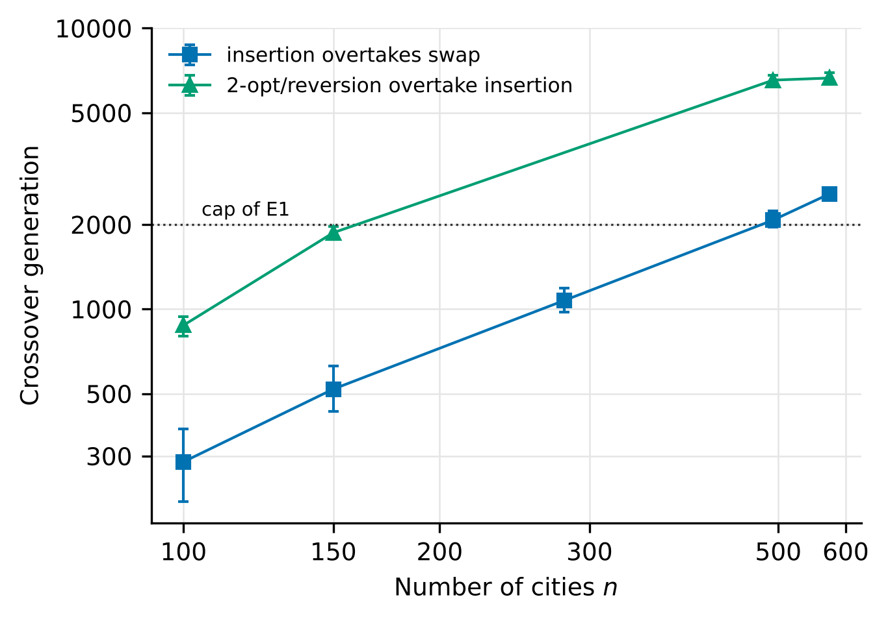
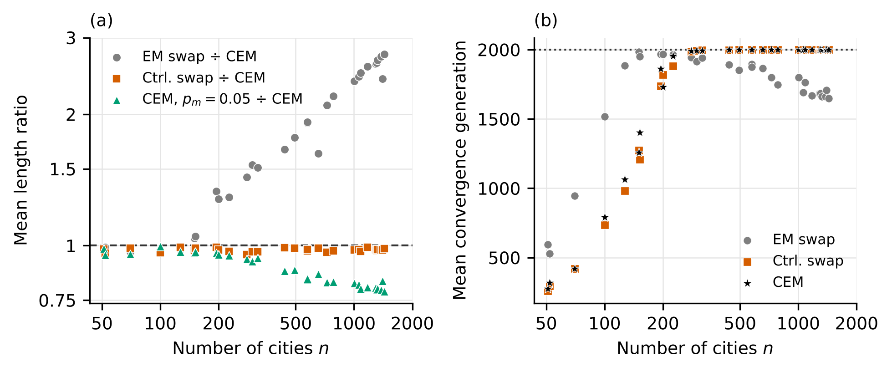

# Controlled versus Essential Mutation in a Genetic Algorithm for the TSP

This repository holds the code, raw results and analysis for a study of mutation in a simple genetic algorithm (GA) for the travelling salesman problem (TSP). It compares two ways of deciding whether a mutation move is kept:

- **Essential mutation (EM).** Edges that appear often in good tours are marked as *essential*. A move is kept only if it removes no essential edge.
- **Controlled mutation.** A move is kept only if it makes the tour shorter, in the spirit of the decision inequalities of the probe-based search of Rahman and Ma (2024).

Both rules are tested with four moves (swap, 2-opt, reversion and insertion) on 30 TSPLIB instances with 51 to 1432 cities. A third rule, **controlled essential mutation (CEM)**, combines the two: a swap is kept only if it removes no essential edge *and* shortens the tour.

---

## Contents

```
controlled-essential-tsp/
├── src/
│   ├── em_vs_c.cpp          EM and controlled variants, final results only      (E1, E4)
│   ├── em_vs_c_diag.cpp     same GA, with checkpoints and move statistics       (E2, E3)
│   └── em_vs_c_cem.cpp      controlled essential mutation                       (CEM, E5)
├── inputs/                  30 TSPLIB instances (.tsp)
├── data/
│   ├── E1_benchmark/        30 instances x 8 variants, 2000 generations
│   ├── E2_trajectories/     6 instances, checkpoints up to 2000 generations
│   ├── E3_long_budget/      d493 and u574, checkpoints up to 10,000 generations
│   ├── E4_large_population/ d493 and u574, 20,000 generations, population 500
│   ├── CEM/                 controlled essential mutation, E1 settings
│   └── E5_CEM_high_rate/    controlled essential mutation, ten times higher mutation rate
├── notebooks/
│   └── analysis.ipynb       rebuilds every table and figure from data/
├── results/                 tables written by the notebook (CSV and LaTeX)
├── figures/                 figures written by the notebook (PNG)
├── requirements.txt
└── README.md
```

---

## 1. Requirements

**C++ programs.** Any compiler with C++17 support (`<filesystem>` is used). Tested with g++ on Windows (MinGW-w64) and on Linux. No external libraries are needed.

**Analysis.** Python 3.9 or newer with the packages in `requirements.txt`:

```bash
pip install -r requirements.txt
```

---

## 2. Building

From the repository root:

```bash
g++ -O2 -std=c++17 src/em_vs_c.cpp      -o em_vs_c
g++ -O2 -std=c++17 src/em_vs_c_diag.cpp -o em_vs_c_diag
g++ -O2 -std=c++17 src/em_vs_c_cem.cpp  -o em_vs_c_cem
```

On Windows the same commands produce `em_vs_c.exe` and so on. Older MinGW versions may need `-lstdc++fs` at the end of the command line.

---

## 3. Running

Always run the programs **from the repository root**. Each program reads every `.tsp` file in `inputs/` (or only the instances listed in `INST_ONLY`) and writes its results into a new folder `output/`. Every file name carries a time stamp, so earlier results are never overwritten.

```bash
./em_vs_c          # E1 with the settings below
./em_vs_c_diag     # E3 with the settings below
./em_vs_c_cem      # CEM with the settings below
```

Progress is printed to the console, one line per run.

### 3.1 Settings of each experiment

All settings are constants at the top of each source file. The files ship with the settings of **E1**, **E3** and **CEM**. To repeat E2, E4 or E5, change the constants listed in the table and rebuild.

| Exp. | Program | `POP_SIZE` | `ELITE_SIZE` | `GENERATIONS` | `MUT_RATE` | `N_RUNS` | `INST_ONLY` |
|:--|:--|--:|--:|--:|--:|--:|:--|
| E1 | `em_vs_c.cpp` | 300 | 60 | 2000 | 0.005 | 30 | `{}` (all 30) |
| E2 | `em_vs_c_diag.cpp` | 200 | 50 | 2000 | 0.005 | 20 | `{"kroA100", "ch150", "a280", "d493", "u574", "fl1400"}` |
| E3 | `em_vs_c_diag.cpp` | 200 | 50 | 10000 | 0.005 | 20 | `{"d493", "u574"}` |
| E4 | `em_vs_c.cpp` | 500 | 100 | 20000 | 0.005 | 50 | `{"d493", "u574"}` |
| CEM | `em_vs_c_cem.cpp` | 300 | 60 | 2000 | 0.005 | 30 | `{}` (all 30) |
| E5 | `em_vs_c_cem.cpp` | 200 | 50 | 2000 | 0.05 | 30 | `{}` (all 30) |

CEM uses exactly the settings and seeds of E1, so it can be compared run by run with the other E1 variants. E5 repeats CEM with a smaller population and a ten times higher mutation rate.

In every experiment the essential rate is `ESS_RATE = 0.1` and run `r` (r = 1, ..., `N_RUNS`) uses the seed `BASE_SEED + r` with `BASE_SEED = 1`. All variants therefore see the same seeds, so runs can be paired.

The diagnostic program also has a list of checkpoints:

```cpp
const vector<int> CHECKPOINTS = {1, 10, 25, 50, 100, 200, 300, 500, 750, 1000, 1500, 2000};                 // E2
const vector<int> CHECKPOINTS = {1, 100, 500, 1000, 2000, 3000, 4000, 5000, 6000, 8000, 10000};             // E3
```

### 3.2 Run time

Measured on a laptop, single thread:

| Exp. | Approximate total time |
|:--|:--|
| E1 | 10 h |
| E3 | 1 h |
| E4 | 14 h |
| CEM | 2 h |
| E5 | 1 h |

To try things out quickly, set `INST_ONLY` to a small instance, for example `{"eil51"}`, which finishes in a few minutes for all eight variants.

### 3.3 Reproducibility

The programs use `std::mt19937_64` with fixed seeds, so the results do not depend on the machine. The published results were produced on Windows, and a Linux build gives identical numbers: running `em_vs_c` with the E1 settings and `INST_ONLY = {"eil51"}` reproduces the eil51 rows of `data/E1_benchmark/ALL_EMvsC_summary_20261015_112256.csv` exactly. The same holds for `em_vs_c_cem` and the E5 summary. The files in `data/CEM` were produced with the Linux build, so their run times are not comparable with those of E1. Only the run times differ between machines.

---

## 4. Output files

| File | Columns | Content |
|:--|:--|:--|
| `ALL_EMvsC_summary_<stamp>.csv` | `Instance, Variant, Best, Avg, Std, AvgConvGen, StdConvGen, AvgTime, p_vs_twin` | One row per instance and variant. `p_vs_twin` is the two-sided Mann–Whitney *p*-value against the same move with the other acceptance rule. |
| `ALL_CEM_summary_<stamp>.csv` | `Instance, Variant, Best, Avg, Std, AvgConvGen, StdConvGen, AvgTime` | Same for CEM. |
| `<instance>_<variant>_runs_<stamp>.csv` | `Best, ExecutionTime, ConvGen, Plot` | One row per run. `Plot` is the best tour as a list of TSPLIB city ids. |
| `<instance>_<variant>_FR_<stamp>.csv` | `Best` | Best tour length in every generation of run 1. |
| `DIAG_<stamp>.csv` | `Instance, Variant, Run, Gen, BestSoFar, Attempts, Accepted, GainSum` | Diagnostic program only. One row per run and checkpoint. `Attempts`, `Accepted` and `GainSum` count the valid move attempts, the accepted moves and the total length reduction in the window since the previous checkpoint. |

Variant names are `EM_swap`, `C_swap`, `EM_2opt`, `C_2opt`, `EM_rev`, `C_rev`, `EM_ins`, `C_ins` and `CEM`. Tour lengths use unrounded Euclidean distances and are rounded to one decimal. `ConvGen` is the last generation in which the best length improved.

---

## 5. Reproducing the tables and figures

```bash
cd notebooks
jupyter notebook analysis.ipynb
```

Run all cells. Figure 1 (the flowchart in `figures/fig1_flowchart.*`) is drawn with Graphviz from `figures/fig1_flowchart.dot`:

```bash
dot -Tpng figures/fig1_flowchart.dot -o figures/fig1_flowchart.png
```

The notebook reads only `data/` and `inputs/`, writes tables to `results/` and figures to `figures/`, and takes under a minute. If you produce new results, copy the files from `output/` into the matching folder under `data/` first. The notebook picks up the file in each folder by its prefix, so keep one set of files per folder.

| Notebook section | Tables | Figures |
|:--|:--|:--|
| 1. Settings | T2 | |
| 2. E1 benchmark | T3, T4, T5, S1, S2 | 3, 4 |
| 3. a280 | S3 | 5, S1 |
| 4. Checkpoint runs | T7, S4, S5, S6, S7 | 7, 8, 9, 10 |
| 5. Long budgets | T6 (E3), T6b (E4) | 6 |
| 6. CEM and E5 | T9, T9a, T10, T12, S8 | 11, 12 |
| 7. Move diagram | | 2 |

---

## 6. The algorithm in short



A tour is a permutation $\pi$ of the $n$ cities with length

$$L(\pi) = \sum_{k=1}^{n} d\bigl(c_{\pi(k)}, c_{\pi(k+1)}\bigr), \qquad \pi(n+1) = \pi(1),$$

and fitness $f(\pi) = 1 / L(\pi)$. In every generation the $E$ best tours are copied, the other parents are drawn by roulette wheel, and pairs of parents produce children by cyclic crossover. Mutation is then applied to every child, elites included. Positions are visited by geometric skipping with probability $p_m$ per position, and the partner position is drawn uniformly. There is no other local search.

For a move $M$ that removes the edge set $\mathcal{R}(M)$ and adds $\mathcal{A}(M)$, the gain is

$$\Delta(M) = \sum_{e \in \mathcal{R}(M)} d(e) - \sum_{e \in \mathcal{A}(M)} d(e).$$

| Rule | A move is kept if |
|:--|:--|
| Controlled | $\Delta(M) > 10^{-9}$ |
| EM | $\mathcal{R}(M) \cap E_{\mathrm{ess}} = \varnothing$ |
| CEM (swap only) | $\mathcal{R}(M) \cap E_{\mathrm{ess}} = \varnothing$ and $\Delta(M) > 10^{-9}$ |

The essential set $E_{\mathrm{ess}}$ is rebuilt every generation from the children. Each edge gets the mean fitness of the children that contain it, and the top 10% of the distinct edges are marked essential.

**Why such a simple GA?** Cyclic crossover and roulette selection are weak choices for the TSP, and they are used on purpose. The original EM study used the same GA, because its aim was to measure the effect of the mutation rather than to build a strong solver. A strong crossover such as order crossover or edge assembly, combined with tournament selection, improves tours largely on its own and would hide the effect of the mutation.

**Why does CEM use swap?** EM changes the cities on non-essential edges by swap mutation, not by a local search. CEM keeps that design and only adds the improvement test. It is still a random swap mutation: it does not search a neighbourhood for the best swap, it just rejects swaps that would make the tour longer.

---

## 7. Study summary and discussion

The study asks three questions.

1. Does improvement-only (controlled) acceptance beat essential-edge protection?
2. Why does the best controlled move depend on the size of the instance?
3. Do essential edges still help once moves must improve the tour?

### 7.1 Controlled mutation beats EM

Across the 30 instances of E1, controlled mutation wins 111 of the 120 per-instance tests (four moves times 30 instances), ties 9 and loses none. The median reduction in mean tour length is 42% to 46% depending on the move, and the signed-rank test over the 30 instance means gives *p* between 1.9 × 10⁻⁹ and 6.1 × 10⁻⁸. All nine ties involve swap or insertion on instances with at most 127 cities. For swap and insertion the advantage grows with instance size.



The gap does not close with a longer budget. After 10,000 generations (E3) the EM tours on d493 and u574 are still 1.9 to 4.0 times longer than the controlled ones. In E4 every variant gets a population of 500 and 20,000 generations. Controlled mutation still wins all eight comparisons, with EM tours 1.5 to 6.4 times longer. Note that E1 already runs EM at the mutation rate that the tuning of the original EM study favours for it (0.005).



A likely reason shows up in the move counts. EM swap accepts about 90% to 95% of its valid attempts throughout a run, because almost no random swap removes an essential edge. On a good tour, though, most random swaps make it longer. A test that lets nearly every swap through also lets in a lot of noise. This is an interpretation, since the gain per accepted move was not recorded for EM.

### 7.2 The best controlled move depends on the budget, not only on the size

At the 2000-generation cap of E1, 2-opt or reversion wins every instance with n ≤ 152, insertion wins 6 of the 7 instances between 195 and 439 cities, and swap wins 14 of the 16 instances with n ≥ 493.



The checkpoint runs show that these regions are not fixed niches. During a run the lead passes from swap to insertion and then to 2-opt/reversion. On d493 and u574 the order at 10,000 generations is the exact reverse of the order at 1000 generations. From generation 3000 on, insertion beats swap in all 20 paired runs on both instances, and from generation 8000 on, 2-opt beats insertion in all 20.



The generation at which the lead changes grows roughly in proportion to n. The log–log slope is 1.23 for insertion overtaking swap (about 3 to 5 times n generations) and 1.14 for 2-opt/reversion overtaking insertion (about 9 to 13 times n). Placing the 2000-generation cap on this timeline predicts a 2-opt/insertion boundary between n = 150 and 280 and an insertion/swap boundary near n = 480, which is where the benchmark puts them. fl1400 is the one instance that does not follow this pattern.



The move statistics fit this picture. The acceptance rate and the gain per accepted move collapse first for swap (which changes 4 edges), then for insertion (3 edges), while 2-opt and reversion (2 edges) keep improving. A move that changes more edges seems to need more luck once the tour is already good. This mechanism has not been tested by intervention.

**Practical message.** A ranking of mutation moves found at one generation cap is a statement about that budget, not about the moves. Studies should report the instance size together with the budget, and ideally show results at several budgets.

### 7.3 Controlled essential mutation

CEM runs with exactly the settings and seeds of E1, so it differs from controlled swap only in the essential-edge test and from EM swap only in the improvement test.

- **Against EM swap**, CEM is a median 42% shorter (shorter on 25 of 30 instances, 24 significant wins, no losses), and the gain grows with n. The improvement test is what EM was missing.
- **Against controlled swap**, CEM is longer on all 30 instances, by a median of 2.2% (17 significant losses, 13 ties, no wins). The penalty is the same at every instance size. Once a move has to shorten the tour, protecting the essential edges only removes some of the improving moves.
- **E5** runs CEM with a ten times higher mutation rate (about 10n instead of 1.5n mutation attempts per generation). It is shorter than CEM in E1 on all 30 instances, by a median of 13%, and by 20% above 1000 cities. At these settings CEM looks better than controlled swap from E1, but the difference comes from the extra mutation attempts, not from the essential edges.



The lesson goes beyond CEM. The number of mutation attempts per generation is part of the budget. Comparisons between acceptance rules are only fair when the population and the mutation rate match.

### 7.4 What the data show, suggest and do not support

| The data show | The data suggest | Not supported |
|:--|:--|:--|
| Controlled mutation beats EM for all four moves, on 30 instances, after 10,000 generations, and with a larger population, 20,000 generations and EM's tuned rate. | EM loses because it accepts almost every swap. | Intrinsic niches of the moves by instance size. |
| The leading controlled move changes during a run on five of six diagnostic instances. | Swap and insertion stall because they change more edges. | Any difference between 2-opt and reversion, which are the same neighbourhood. |
| The generation of each change grows with n, and the predicted boundaries at 2000 generations contain the observed ones. | The crossover generation is close to proportional to n. | A general scaling law, or a ranking at convergence. |
| At identical settings CEM is 42% shorter than EM swap but 2.2% longer than controlled swap, on all 30 instances. A ten times higher rate makes CEM 13% shorter. | The number of move attempts per generation should be reported together with the budget. | That essential edges are useless with other moves, crossovers or schedules. |

### 7.5 Limitations

The study keeps the GA of the original EM study on purpose: cyclic crossover, roulette-wheel selection, random initial tours and a uniformly random partner position. A natural next step is to repeat the comparison with order crossover and edge assembly crossover under tournament selection, where crossover does much more of the work. The size regions and the crossover timeline may look different with nearest-neighbour initialisation, a spatial neighbourhood for the partner, another crossover or an added local search. The experiments differ in population, mutation rate, budget and number of runs (Section 3.1), so results are compared across experiments only where the direction of any bias is clear. The log–log slopes rest on four or five instances.

---

## 8. References

1. Reinelt, G. (1991). TSPLIB: a traveling salesman problem library. *ORSA Journal on Computing*, 3(4), 376–384.
2. Abu Doush, I., Awadallah, M. A., & Al-Betar, M. A. (2022). A novel essential mutation method for evolutionary algorithms. *2022 2nd International Conference on Computing and Machine Intelligence (ICMI)*, 1–5.
3. Abu Doush, I., Al-Khatib, R. M., Alotaibi, B., & Alhatamleh, S. (2026). Essential mutation framework for solving travelling salesman problem. *Cluster Computing*, 29, 49. https://doi.org/10.1007/s10586-025-05789-w
4. Rahman, M. A., & Ma, J. (2024). Two-stage probe-based search optimization algorithm for the traveling salesman problems. *Mathematics*, 12(9), 1340. https://doi.org/10.3390/math12091340
5. Oliver, I. M., Smith, D. J., & Holland, J. R. C. (1987). A study of permutation crossover operators on the traveling salesman problem. *Proceedings of the Second International Conference on Genetic Algorithms*, 224–230.

---

## Authors

Abu Bakkar Siddik and Md. Azizur Rahman, Mathematics Discipline, Khulna University, Khulna 9208, Bangladesh.

The TSPLIB instances in `inputs/` are taken from the public TSPLIB collection.
